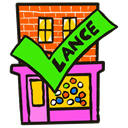

<p align="center">
  
</p>

<h1 align="center">Lance's Shop Checker</h1>

<p align="center">
  A Chrome extension that tells you, before you buy, whether a shopping site looks trustworthy or dodgy.
</p>

---

When you open an online shop, Lance's Shop Checker shows a small box at the top of the page with a verdict:

| | Verdict | What it means |
|---|---|---|
| 🟢 | **This shop looks OK** | Nothing worrying found |
| 🟡 | **Be careful with this shop** | Some warning signs. Have a closer look before you pay. |
| 🔴 | **This shop may be a scam** | Several warning signs, such as a brand-new website with no reviews and huge discounts |

Under the verdict it lists the reasons, so you can judge for yourself. For example:

> 🔴 **This shop may be a scam** · megatrainers-outlet.shop
>
> - ✗ Domain registered only 21 days ago
> - · Not on Trustpilot
> - ! No returns or refund policy link found
> - ✗ Discounts of up to 85% off

It needs no account and no API keys, and it costs nothing.

> **Status:** a working proof of concept, not yet in the Chrome Web Store. You install it yourself in a couple of minutes (see below).

## What it checks

- **How old the website is.** Scam shops are usually only weeks or months old, because they get reported and shut down. Genuine shops have often been around for years. The registration date comes from public domain records ([RDAP](https://rdap.org), the successor to WHOIS).
- **What customers say** on review sites:
  - **Trustpilot**
  - **Sitejabber** (optional)
  - **Reviews.io** (optional)
- **Warning signs on the page itself:** no contact details, no returns or refund policy, discounts of 70% or more, or no secure (https) connection.

The box also links to the shop's page on each review site, so you can read the reviews yourself.

## Install

1. **Download it.** On this GitHub page, click the green **Code** button, then **Download ZIP**, and unzip it somewhere you'll keep it. Or, if you use git:
   ```bash
   git clone https://github.com/ZLKenta/shop_checker.git
   ```
2. In Chrome, go to `chrome://extensions`.
3. Turn on **Developer mode** (top right).
4. Click **Load unpacked** and choose the unzipped folder, the one containing `manifest.json`.
5. Optional: click the jigsaw-piece icon in Chrome's toolbar and pin **Lance's Shop Checker**, so its icon is always visible.

Don't delete or move the folder afterwards, as Chrome runs the extension from there. Chrome may remind you at startup that a developer-mode extension is installed. That's normal for extensions installed this way.

**To update:** download the new version over the old folder (or `git pull`), then click the reload arrow on the extension's card in `chrome://extensions`.

## Using it

- **Just shop as normal.** The box appears by itself on pages that look like shops, and stays until you close it with **×**.
- **Check any page yourself** by clicking the extension's icon in the toolbar. This is handy if a shop wasn't picked up automatically.
- **"Don't check this site again"** at the bottom of the box stops it appearing on a site you trust.

## Settings

Right-click the toolbar icon and choose **Options**, or go to `chrome://extensions` → Lance's Shop Checker → **Details** → **Extension options**.

- **Review sites:** switch Trustpilot, Sitejabber and Reviews.io on or off. All three start on.
- **Sites you've said not to check:** click **Check again** to start checking one again.

Your settings follow your Chrome sign-in to your other computers.

## How it decides

### Is this page a shop?

It looks for signs such as:
- an "Add to basket" or "Buy now" button
- a basket, cart or wishlist link
- product information the page publishes for search engines
- a shop platform like Shopify or WooCommerce
- five or more prices

Two or more signs and it counts as a shop. One isn't enough, as plenty of ordinary pages mention prices or link to a shop.

### The score

Each sign adds or takes away points:

| Sign | Points |
|---|---|
| Website registered under 3 months ago | +4 |
| Website registered 3–6 months ago | +3 |
| Website registered 6–12 months ago | +1 |
| Website registered over 10 years ago | −2 |
| Average review rating 2★ or lower | +3 |
| Average review rating under 3.5★ | +1 |
| Average review rating 4★ or higher (from 50+ reviews) | −2 |
| Not on any review site, or under 10 reviews on each | +1 |
| Discounts of 70% or more | +2 |
| No secure (https) connection | +2 |
| No contact details | +1 |
| No returns or refund policy | +1 |
| None of the checks could be done | +2 |

**Under 2 points is 🟢, 2 to 4 is 🟡, and 5 or more is 🔴.**

The review rating is the average across the review sites with at least 10 reviews, so three sites saying the same thing don't count three times.

### Why big brands can still be green

Big shops like Amazon often have poor ratings on open review sites. Most of their customers never write a review, so the reviews come mainly from people with a problem. Lance's Shop Checker still shows that low rating, but a website that's been running for 20 or 30 years counts strongly in the shop's favour, because scam shops don't last that long.

## Privacy

- **Nothing is sent to us.** There's no server, no account and no tracking.
- To check a shop, the extension sends **the shop's web address** (for example `example-shop.com`, not the page you're on) to:
  - the public domain-records service ([rdap.org](https://rdap.org) and the registry it points to)
  - each review site you've switched on, along with any cookies your browser already holds for that site, just as when you visit it yourself
- Results are saved in your browser for 24 hours, so a shop you visit often is only looked up once a day.

## Known limits

- **Trustpilot sometimes shows a "verifying connection" check** instead of its page. The box then says Trustpilot wasn't checked and gives you the link to look yourself. The extension doesn't try to get past these checks.
- **Some shops aren't detected automatically,** especially ones that build their pages slowly with JavaScript, or show their basket only as a picture. Click the toolbar icon to check them.
- **Reviews.io only finds a shop** if its page name there follows a common pattern, like `gymshark-com` for gymshark.com.
- **Not for the Chrome Web Store as it is.** The review sites' terms don't allow automated reading of their pages, which is fine for personal use but not for a published extension.

## For developers

Plain JavaScript, no build step. After changing a file, click the reload arrow on the extension's card in `chrome://extensions`, then reload the page.

| File | What it does |
|---|---|
| `manifest.json` | The extension's name, icons and permissions |
| `content.js` | Runs on each page: decides whether it's a shop, reads its warning signs, and draws the box |
| `background.js` | Does the lookups, caches the results, and remembers the sites not to check |
| `checks.js` | The lookups for domain age and each review site, and the scoring |
| `options.html`, `options.js` | The settings page |
| `icons/` | The icon at 16, 32, 48 and 128 px, made from `shopchecker.jpeg` |

To add another review site, add an entry to `REVIEW_SITES` in `checks.js`, and it appears on the settings page by itself.
